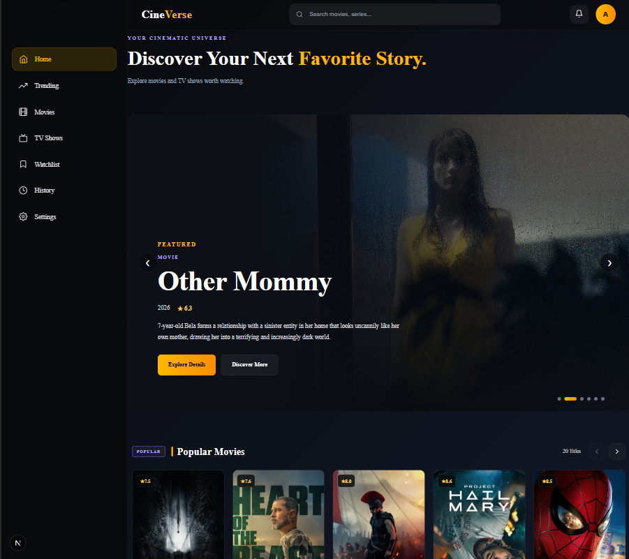
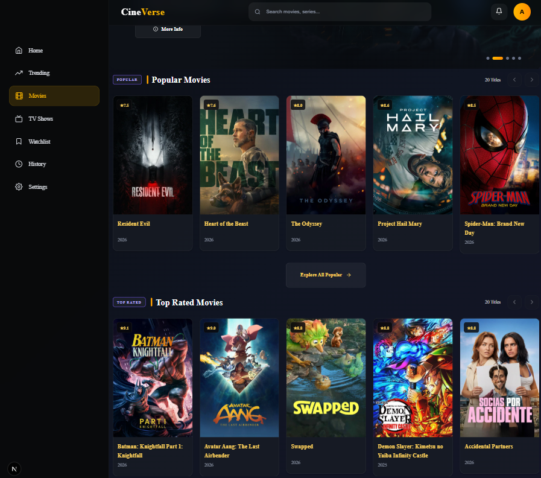
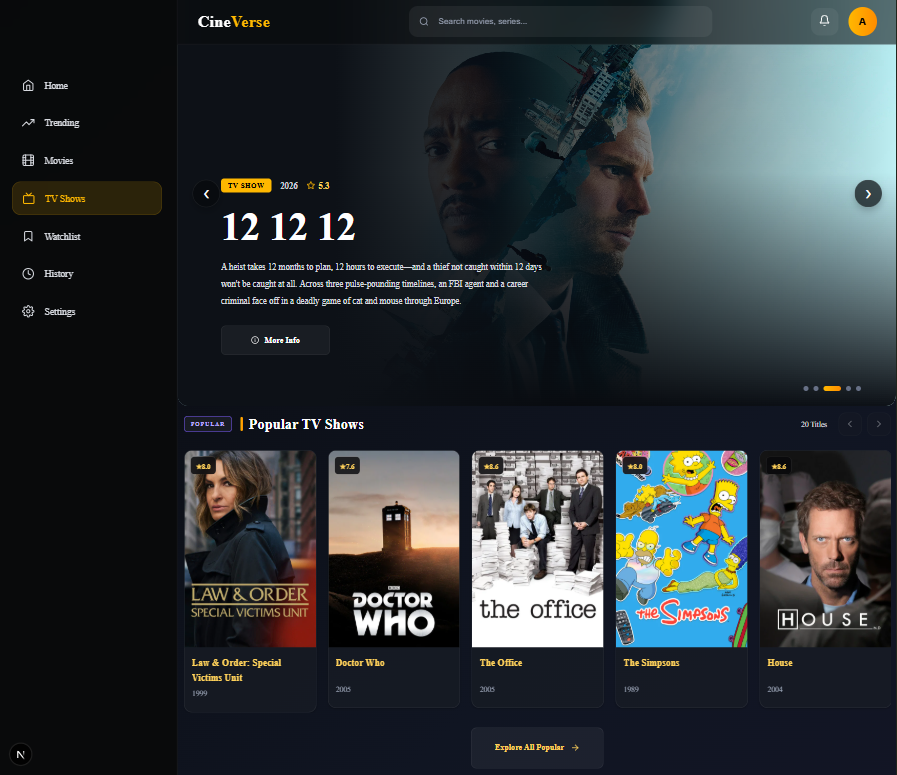
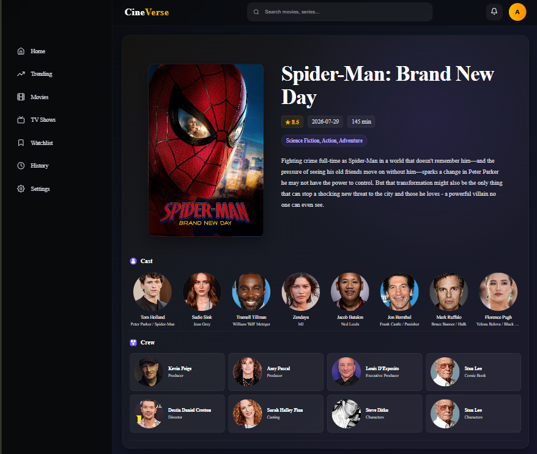
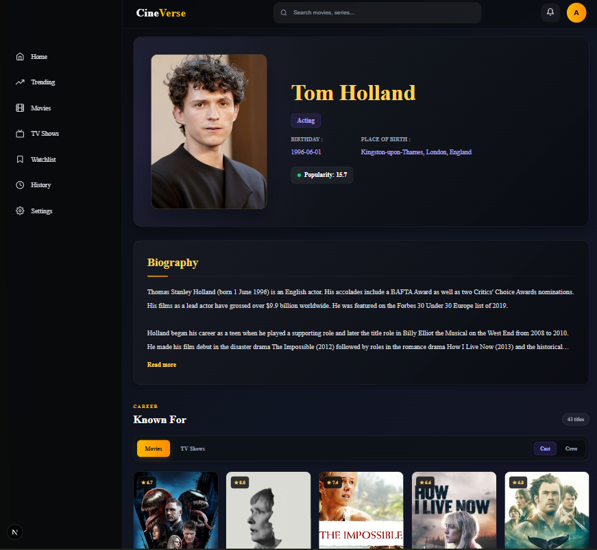

# ClineVerse

### A Movie & TV Discovery Platform

ClineVerse is a movie and TV discovery platform built with Next.js, React, and TypeScript. It allows users to explore movies and TV shows, discover trending content, view detailed information, and browse people involved in the film industry.

---

## Screenshots

### Home Page


### Movies Page


### TV Shows Page


### Media Details Page


### Person Page


---

## Features

- **Movie Discovery:** Browse popular, trending, and upcoming movies.
- **TV Show Discovery:** Explore popular and trending TV shows.
- **Trending Content:** Discover daily and weekly trending movies and TV shows.
- **Media Details:** View detailed information about movies and TV shows.
- **Person Details:** Explore information about actors, directors, and other industry professionals.
- **Cast & Crew:** Browse cast and crew information for movies and TV shows.
- **Responsive Design:** Optimized layouts for desktop, tablet, and mobile devices.
- **Reusable Components:** Modular and reusable UI components for maintainability.

---

## Tech Stack

| Technology | Purpose |
|---|---|
| Next.js | React framework and application routing |
| React | Building user interfaces |
| TypeScript | Static typing and type safety |
| Sass / SCSS | Styling and CSS architecture |
| TanStack Query | Server-state management and data fetching |
| Axios | HTTP requests and API communication |
| TMDB API | Movie, TV show, and person data |

---

## Project Architecture

The project follows a modular structure to keep features organized and maintainable.

```text
src/
├── app/                  # Next.js App Router pages
├── modules/              # Feature-based page modules
│   ├── home-page/
│   ├── media-details-page/
│   ├── media-page/
│   ├── person-page/
│   ├── popular-movies-page/
│   ├── trending-movies-page/
│   ├── trending-page/
│   └── trending-series-page/
├── shared/               # Shared application resources
│   ├── api/
│   ├── components/
│   ├── routes/
│   └── sass/
└── utils/                # Utility functions and services
```

### Architecture Principles

- Feature-based modular organization.
- Reusable shared components.
- Separation of UI components, API logic, and utility functions.
- Type-safe development with TypeScript.
- Server-state management with TanStack Query.
- Centralized API configuration and communication.

---

## Getting Started

Follow these steps to run the project locally.

### Prerequisites

Make sure you have the following installed:

- Node.js
- npm
- A TMDB API account and API credentials

### Installation

1. Clone the repository:

   ```bash
   git clone https://github.com/ali-najari/clineverse.git
   ```

2. Navigate to the project directory:

   ```bash
   cd clineverse
   ```

3. Install dependencies:

   ```bash
   npm install
   ```

4. Create a `.env.local` file in the root directory and configure the environment variables:

   ```env
   NEXT_PUBLIC_APP_BRANCH=dev
   NEXT_PUBLIC_TMDB_IMAGE_BASE_URL=https://image.tmdb.org/t/p
   NEXT_PUBLIC_API_MAIN=https://api.themoviedb.org/3
   NEXT_PUBLIC_API_TEST=https://api.themoviedb.org/3
   ```

   Add your TMDB credentials according to the API authentication setup used by the project.

5. Start the development server:

   ```bash
   npm run dev
   ```

6. Open the application:

   ```text
   http://localhost:3000
   ```

### Build

To create an optimized production build:

```bash
npm run build
```

---

## API Reference

ClineVerse uses the [TMDB API](https://developer.themoviedb.org/docs) to retrieve movie, TV show, and person information.

All media data, including images and metadata, is provided by TMDB.

---

## Git Workflow

The project uses separate branches for stable and ongoing development:

- **main:** Stable branch.
- **dev:** Development branch containing the latest project changes.

New features and improvements are developed on `dev` before being considered for the stable branch.

---

## Security

Environment-specific configuration is stored in local environment files.

- `.env.local` should never be committed to the repository.
- Do not commit API credentials or private access tokens.
- Variables prefixed with `NEXT_PUBLIC_` are exposed to client-side code.
- For production environments, sensitive API credentials should be handled through a server-side API layer.

---

## License

No license has been specified for this project yet.
